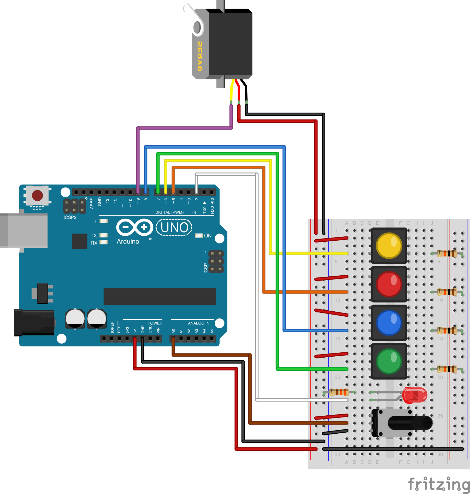
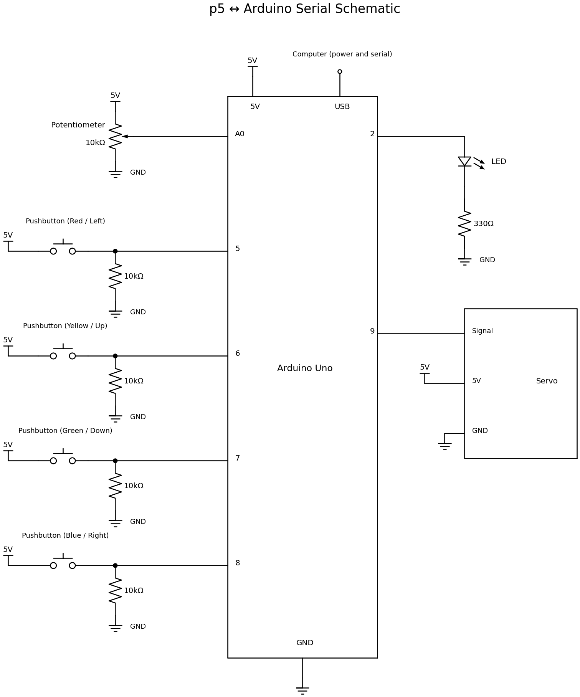

# p5 ↔ Arduino Serial

Learn how a p5.js sketch and an Arduino talk to each other over the USB
cable, one small step at a time. You start by reading a potentiometer and
finish with a game that uses buttons, a potentiometer, an LED and a servo.

The sketches use the
[p5.webserial library by gohai](https://github.com/gohai/p5.webserial).

## What you need

- An Arduino Uno and its USB cable
- A breadboard and jumper wires
- A potentiometer
- 4 pushbuttons and 4 resistors of 10kΩ
- An LED and a 330Ω resistor
- A servo
- Chrome or Edge. Other browsers can't use the serial port.

## How they talk

The Arduino and p5 send each other short messages made of text. Each
message is one line: a word that says what kind of message it is, then
sometimes a value.

| Who sends it | Message | What it means |
| --- | --- | --- |
| Arduino → p5 | `POT 512` | the potentiometer reading, from 0 to 1023 |
| Arduino → p5 | `B 0,1,0,0` | the four buttons: 1 is pressed, 0 is not |
| p5 → Arduino | `LED ON` | turn the LED on |
| p5 → Arduino | `LED OFF` | turn the LED off |
| p5 → Arduino | `SERVO 90` | move the servo to 90 degrees (0 to 180) |

The Arduino only sends a reading when it changes.

## 1. Build the circuit



- **Potentiometer:** middle leg to A0, the outer legs to 5V and GND
- **Buttons:** one side to 5V. The other side to its pin, and through a
  10kΩ resistor to GND. Yellow is pin 6, red is pin 5, blue is pin 8 and
  green is pin 7.
- **LED:** long leg to pin 2, short leg through a 330Ω resistor to GND
- **Servo:** three jumper wires from the socket on its lead. Signal
  (yellow or orange) to pin 9, red to 5V, black or brown to GND.

Red wires are 5V and black wires are GND. Each resistor goes straight into
the - rail, and one black wire at the bottom joins the two - rails.

Wire all four buttons and their resistors before you start, even for the
first steps. A button pin with no resistor isn't connected to anything, and
the Arduino will send `B` messages with random values.

More room to work? Here is the same circuit on a
[full-size breadboard](p5ArduinoSerial_breadboard.png). The schematic shows
what is connected to what:



## 2. Upload the Arduino sketch

Open [p5ArduinoSerial.ino](p5ArduinoSerial.ino) in the Arduino IDE and
upload it. You only do this once: the same Arduino sketch is used for every
step.

## 3. Try it by hand

Before using p5, talk to the Arduino yourself.

1. **Arduino talks, you listen.** Open the Arduino Serial Monitor, set to
   9600 baud, and turn the potentiometer. You will see messages like
   `POT 512`. Press a button to see `B 0,1,0,0`.
2. **You talk, Arduino listens.** Set the line ending to "New Line", type
   `LED ON` and press enter. Then try `LED OFF` and `SERVO 90`. You are
   doing by hand what p5 will do next.

**Close the Serial Monitor when you are done.** Only one program can use
the serial port at a time, so p5 can't connect while it is open.

## 4. The p5 sketches

Open each sketch in the p5 editor, press play, and click "Connect to
Arduino". To change one, use File > Duplicate to make your own copy.

| Sketch | What it does | What is new |
| --- | --- | --- |
| [1. Read the pot](https://editor.p5js.org/mangtronix/sketches/BK4nCyyIk) | The potentiometer sets the size of a circle | p5 reads a message and takes the number out of it |
| [2. Control the LED](https://editor.p5js.org/mangtronix/sketches/2F9qXmmkm) | Two buttons on the page switch the LED | p5 sends a message |
| [3. Both directions](https://editor.p5js.org/mangtronix/sketches/5ne2zOz-E) | Both of the above in one sketch | Sending and receiving at the same time |
| [4. Buttons](https://editor.p5js.org/mangtronix/sketches/wYxJaFu3n) | Each button on the breadboard shows an arrow | Two kinds of message, and several values in one message |
| [5. Servo](https://editor.p5js.org/mangtronix/sketches/vO1mlVwjb) | A slider on the page moves the servo | p5 sends a message with a value, and only when it changes |
| [6. Game](https://editor.p5js.org/mangtronix/sketches/I8v7OI_Z1) | Catch the dots before the servo clock runs out | Everything together |

In the game, the buttons move a net (yellow up, red left, blue right, green
down) and the potentiometer sets its size: a big net catches dots more
easily but moves more slowly. The LED flashes for each catch, and the servo
arm counts down the 30 seconds. Press any button to start.

The same sketches are in the folders here (`p5-1-read-pot` and so on), if
you would rather read the code on GitHub.

## See the messages

The [Serial Visualizer](https://editor.p5js.org/mangtronix/sketches/z3XNYpZA1)
draws the messages travelling between the Arduino and p5 in slow motion,
next to the lines of code that send and receive them.

- It works without an Arduino: it starts with a pretend one. Drag the
  potentiometer or click the buttons in the picture.
- "Show input" and "Show output" choose which message to follow.
- "When to send" switches between sending only when a reading changes and
  sending every time round `loop()`.
- Press Fullscreen to hide the code.

## See the messages of your own sketch: serialTap

The Arduino Serial Monitor can't be open while p5 is connected, so you
can't use it to see what the two sides are saying. `serialTap.js` shows
you instead: it prints every message that goes through the serial port, in
both directions, to the console.

**Add it.** Put this one line in your sketch's `index.html`, next to the
other `<script>` lines. You don't change `sketch.js` at all, and there is
no file to upload.

```html
<script src="https://cdn.jsdelivr.net/gh/mangtronix/IntroductionToInteractiveMedia@master/code/serialTap.js"></script>
```

**Open the console.** In the p5 editor it is the panel under your code. In
a browser tab, press F12 (Windows) or Cmd+Option+J (Mac).

**Run your sketch.** The first line appears straight away and tells you
serialTap is loaded. The rest appear once you connect:

```text
serialTap loaded. Messages will be shown here once the serial port is open
[serial] port opened at 9600 baud
Arduino → p5    POT 512\r\n
p5 → Arduino    LED ON\n
Arduino → p5    B 0,1,0,0\r\n
Arduino → p5    … same ×57
[serial] port closed
```

How to read it:

- **The arrow says who sent the message.** `Arduino → p5` is something the
  Arduino sent; `p5 → Arduino` is something your sketch sent.
- **`\r` and `\n` are the line ending**, the invisible characters that mark
  the end of a message. They are written out so you can check them.
  `Serial.println()` on the Arduino ends a message with `\r\n`; the p5
  sketches here end theirs with `\n`.
- **`… same ×57`** means the same message was sent 57 more times in a row.
  Repeats are counted, not printed, so the console doesn't fill up.
- **`[serial]` lines** are about the connection itself: the port opened,
  closed, couldn't be opened, or the cable was unplugged.

What to look for when something is wrong:

| You see | It usually means |
| --- | --- |
| No `serialTap loaded` line | serialTap didn't load. Check the `<script>` line in `index.html` |
| `[serial] couldn't open the port` | Something else is using the Arduino. Close the Serial Monitor and any other tab that is connected to it |
| `[serial] no port was chosen` | The list of ports was closed without picking one. Press Connect again |
| Nothing after `port opened` | The Arduino isn't sending. Is the right sketch uploaded? |
| Strange characters like `�x�` | The speeds don't match. Check `Serial.begin()` and `port.open()` |
| A message with no `\n` at the end | The Arduino used `Serial.print()` where it needs `Serial.println()`, so p5's `readUntil("\n")` never finds the end |
| No `p5 → Arduino` lines when you expect them | Your sketch isn't sending. Check the code that calls `port.write()` |
| Hundreds of the same message | You are sending every frame. Send only when the value changes |

Settings, if you want them. Put one of these in `setup()`, or type it in
the console while the sketch runs:

```js
serialTap.mode = "all"; // print every message, including repeats
serialTap.mode = "off"; // print nothing
serialTap.mode = "collapse"; // back to counting repeats (the default)
```

It works with any sketch that uses p5.webserial, in Chrome and Edge. The
file itself is [serialTap.js](../serialTap.js), if you want to read it or
keep your own copy.

## If it doesn't work

- **Nothing happens when you click Connect, or the port is missing.** Close
  the Arduino Serial Monitor. Check you are using Chrome or Edge.
- **Garbage characters, or nothing arrives.** Both sides must use the same
  speed. The sketches use 9600.
- **The arrows flicker on their own.** A button is missing its 10kΩ
  resistor to GND, or the resistor is in the wrong row.
- **The LED doesn't light.** Turn it around: the long leg goes to pin 2.
  The small LED on the Arduino board does the same thing, so you can check
  there.
- **The servo twitches or the Arduino restarts.** The servo needs more
  power than the USB port is giving. Try another USB port or a powered hub.

## Going further

- **Faster serial.** 9600 baud carries about 960 characters a second, which
  is plenty here. If your project sends much more, change both sides to
  57600: `Serial.begin(57600);` on the Arduino and `port.open(57600);` in
  p5. Each sketch has that line ready, commented out.
- **Several values in one message.** The Week 11 bidirectional example
  sends values separated by commas, e.g. `512,301`, the same way the `B`
  message does here.
- **Your own messages.** Pick a new first word, send it from one side, and
  add one more `if` on the other side to act on it.

## For instructors

- Each sketch here has a copy in the p5 editor, linked at the top of its
  `sketch.js`. When you change one, change the other.
- The pages load p5.js the way the p5 editor sets up a new sketch, so the
  version can be changed from the editor's settings. `check_sketches.mjs`
  runs all the sketches without an Arduino, on that version and on the
  newest p5.js, to find out whether it is safe to move to a newer one.
- The `serialTap.js` line above is served by jsDelivr straight from this
  GitHub repository. After the file changes on GitHub it can take up to a
  day for the new version to reach everyone.
- The pictures are generated: `p5ArduinoSerial_schematic.py` makes the
  schematic and `p5ArduinoSerial_breadboard.py` makes the two
  [Fritzing](https://fritzing.org) files.

Made by Michael Ang with Claude Fable 5.2. MIT License.
